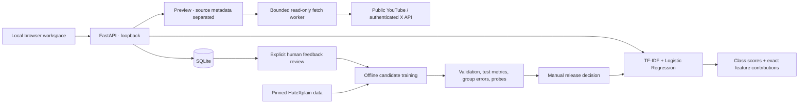

# Architecture

The browser has no external runtime dependencies. All text rendering escapes user-controlled data; theme preference is the only persistent browser storage. The server stores analyses, original model versions/explanations, local moderation states, and feedback in SQLite with parameterized queries and foreign keys.

## Boundaries

- `text.py` is shared by training, inference, highlighting, and duplicate checks.
- `dataset.py` owns corpus provenance, majority-vote conversion, and disjoint normalized text splits.
- `model.py` owns vectorization, probabilities, exact pairwise logit contributions, and heuristic review routing.
- `evaluation.py` owns classification metrics, group error definitions/intervals, and explicit diagnostic fixtures.
- `storage.py` owns database transactions and feedback state transitions.
- `imports.py` owns deterministic TXT/clipboard, CSV, and JSON extraction, duplicate markers, and length checks.
- `social.py` validates and canonicalizes URLs, fetches public YouTube comments with yt-dlp, and retrieves recent X conversation replies with bearer authentication. `social_worker.py` runs fetches under a 55-second subprocess deadline; two concurrent fetches are allowed. X HTTP redirects are disabled, and tokens travel via stdin/HTTPS headers rather than arguments or URLs. Provider diagnostics are not echoed with secrets.
- `app.py` validates requests, loads one immutable model per server process, and exposes the local API.
- `train.py` runs outside the web server. Model artifacts are written atomically and only after convergence/evaluation.

## HTTP API

| Method | Route | Purpose |
| --- | --- | --- |
| GET | `/api/status` | Readiness, model metadata, current workspace counts |
| POST | `/api/analyze` | Analyze and save one comment |
| POST | `/api/analyze/batch` | Validate and analyze up to 50 comments |
| GET | `/api/comments` | Paginated labels, source, review-only filter, literal text search |
| GET | `/api/import/providers` | Provider capabilities and token-configured boolean, never the token |
| POST | `/api/import/preview` | Extract supplied text/files without saving or inference |
| POST | `/api/import/link` | Fetch a bounded YouTube/X preview without saving or inference |
| POST | `/api/import/analyze` | Analyze selected rows; save source metadata separately |
| GET | `/api/comments/{id}` | Original analysis and current workflow state |
| POST | `/api/comments/{id}/moderation` | Save/reverse a local moderation decision |
| POST | `/api/comments/{id}/feedback` | Submit one feedback record for an analysis |
| GET | `/api/feedback` | Paginated feedback history by status |
| POST | `/api/feedback/{id}/review` | Accept an adjudicated label or reject feedback |
| GET | `/api/audit` | Measured audit stored with the active model |
| POST | `/api/audit/probes` | Re-run the fixed diagnostic examples |
| GET | `/api/export` | Evaluation and counts, excluding submitted comment text |
| GET | `/api/docs` | Generated OpenAPI documentation |

Request bodies and constraints are documented by OpenAPI. Invalid batch input is rejected before inference begins. Individual valid batch results are persisted separately; an unexpected runtime/disk failure may leave a partial batch, which remains visible in the analysis history.

Imported predictions use deterministic IDs derived from preview session, platform, canonical source URL, row ID, content/metadata digest, and model version. A retry in the same session reuses saved predictions; a changed row produces a new record. The database insert also handles concurrent retries. The browser retains completed chunks and retries the remaining selection. Reloading creates a new session, so cross-session deduplication is not promised.

Only comment text enters `model.predict`. Author, timestamp, engagement counts, external IDs, and conversation URL are provenance, not classifier inputs. YouTube samples may reflect provider ranking; X recent search covers seven days and can omit older replies. These imports do not establish new target-domain performance or fairness metrics.

## State transitions

Feedback: `pending → accepted | rejected`. A reviewed record cannot be silently overwritten. Acceptance requires a category. Feedback does not rewrite the original prediction or implicitly resolve moderation: these are separate judgments.

Moderation: `unresolved ↔ approved | hidden | review`. These reversible decisions affect the local review queue only. A comment is in that queue if its prediction requires review or it was manually queued, unless approved/hidden.

The application is a single-user local environment. Trusted-host checking and same-origin writes reduce accidental browser-origin access, but are not substitutes for authentication. A hosted subscriber product requires accounts, isolated data ownership, reviewer permissions, rate limits, retention controls, and a proper deployment design before exposure.
